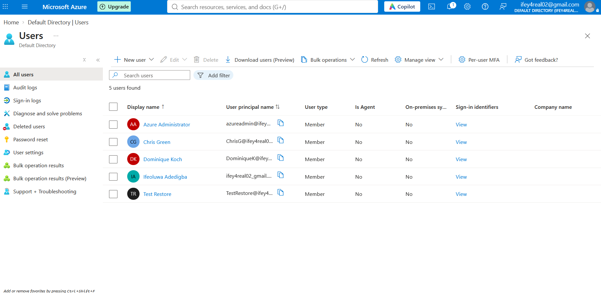
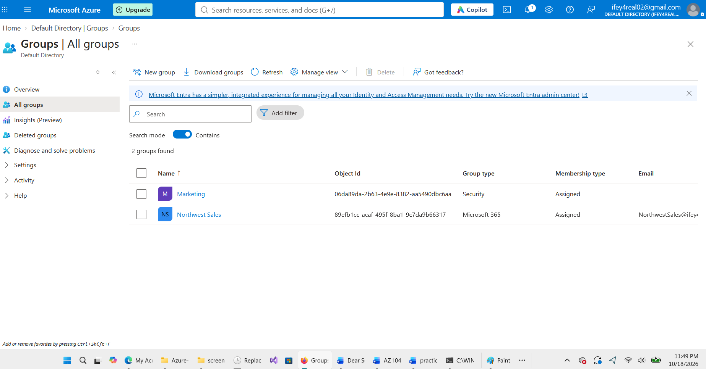
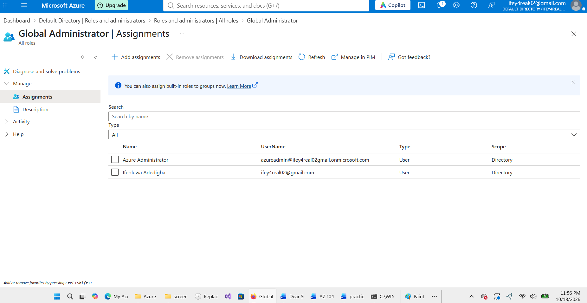
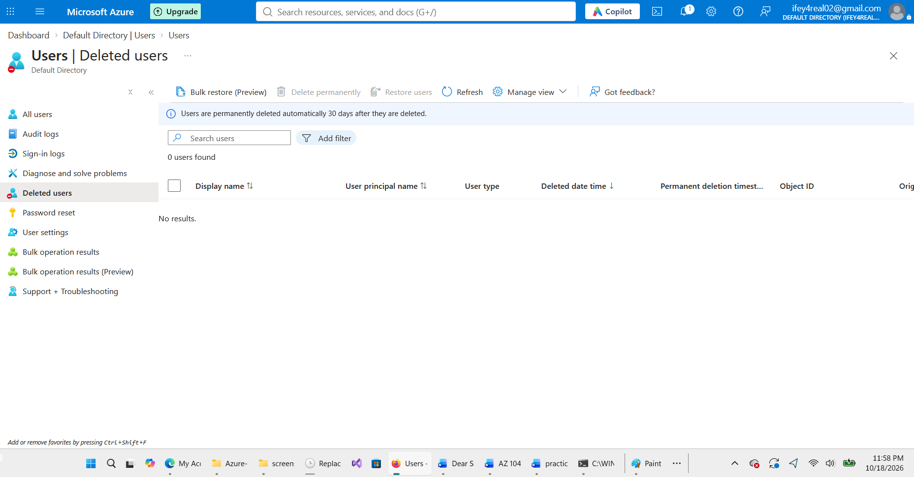

# Lab 01 — Manage Microsoft Entra ID

## Overview

This lab demonstrates hands-on experience managing identities, groups, and administrative roles using Microsoft Entra ID in the Azure portal.

The exercises focused on user lifecycle management, group administration, role-based access control, and identity restoration.

## Objectives

- Create and manage Microsoft Entra ID users.
- Create and configure security and Microsoft 365 groups.
- Explore administrative roles and directory-level permissions.
- Practice deleting and restoring a user account.
- Understand the difference between Microsoft Entra administrative roles and Azure RBAC roles.

## Lab Environment

| Component            | Description                            |
| -------------------- | -------------------------------------- |
| Platform             | Microsoft Azure                        |
| Identity service     | Microsoft Entra ID                     |
| Management interface | Azure portal                           |
| Lab focus            | Identity and access management         |
| Certification track  | AZ-104 — Microsoft Azure Administrator |

## Hands-On Activities

### 1. User Management

Created and managed Microsoft Entra ID user accounts, including:

- Chris Green
- Dominique Koch
- Azure Administrator
- Test Restore (used for the deletion and restoration exercise)

Reviewed user accounts through **Microsoft Entra ID → Users → All users**.

### 2. Group Management

Created and explored two Microsoft Entra groups:

- **Marketing:** Security group
- **Northwest Sales:** Microsoft 365 group

Learned how groups help administrators organize identities and manage access.

### 3. Administrative Roles

Reviewed Microsoft Entra ID administrative roles and their assignments.

Verified that two accounts had the **Global Administrator** role at the directory scope.

Learned that Microsoft Entra administrative roles manage directory permissions, while Azure RBAC roles control access to Azure resources.

### 4. User Lifecycle Management

Practiced deleting and restoring a Microsoft Entra ID user account.

Reviewed the **Deleted users** page to understand the user recovery process.

### 5. Licensing

Explored Microsoft Entra user licensing. A license assignment could not be completed because the required licenses were unavailable in the lab environment.

## Screenshots

### Microsoft Entra Users

### Microsoft Entra Groups

### Global Administrator Role Assignments

### Deleted Users

## Key Learning Outcomes

- Understood the fundamentals of cloud identity administration.
- Practiced managing Microsoft Entra ID users and groups.
- Examined directory-level administrative roles.
- Gained experience with user deletion and restoration.
- Recognized the difference between identity administration and Azure resource permissions.

## Notes

This lab was completed in a personal Microsoft Entra ID learning environment as part of practical preparation for the **Microsoft AZ-104 certification**.

Some licensing-related activities could not be completed because the necessary licenses were unavailable.
