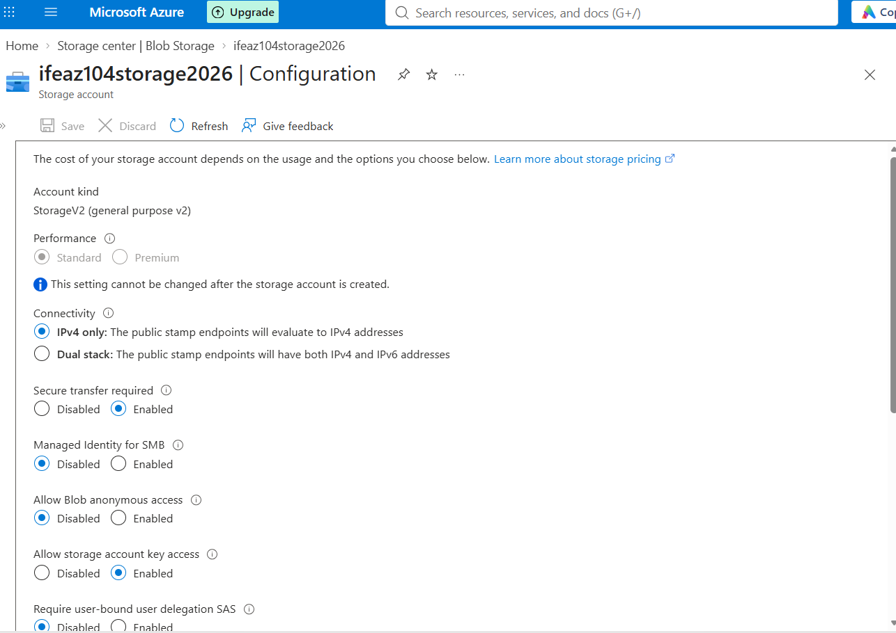
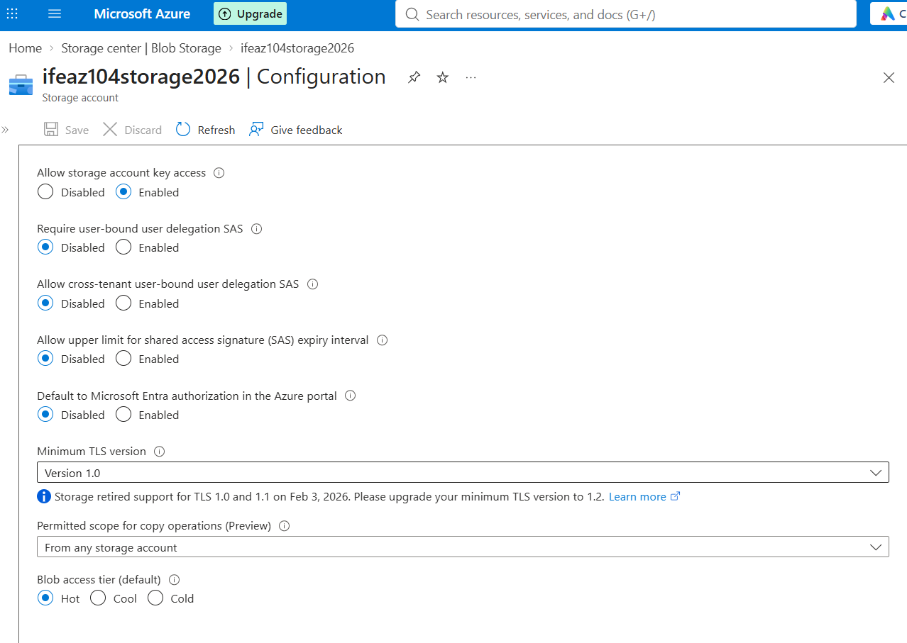
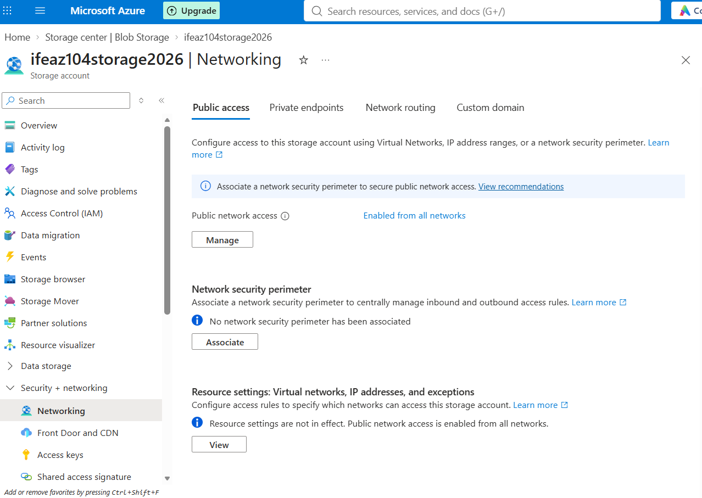
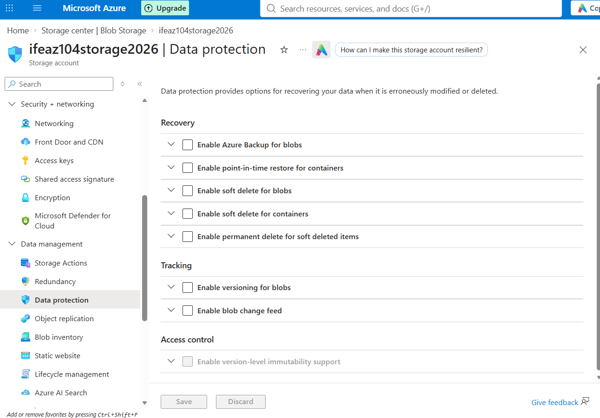
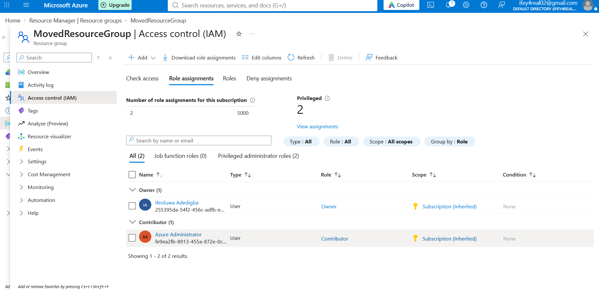
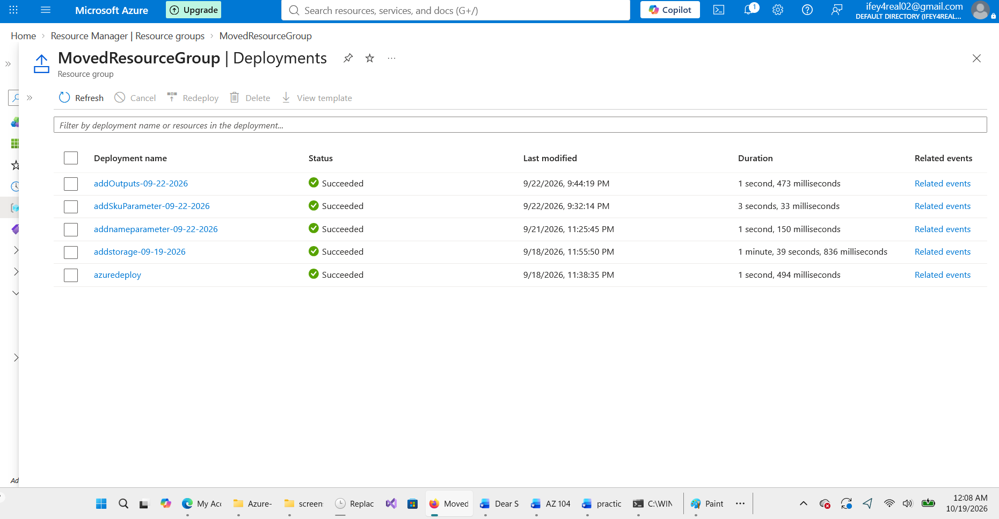

# Lab 02 — Manage Azure Storage

## Overview

This lab demonstrates hands-on experience deploying, configuring, and reviewing an Azure Storage account through the Azure portal.

The exercises focused on storage account configuration, networking, data protection, access control, deployment history, and exporting an Azure Resource Manager (ARM) template.

## Objectives

- Deploy and configure an Azure Storage account.
- Review storage performance and redundancy options.
- Examine storage account networking and security settings.
- Explore data protection and recovery settings.
- Review role-based access control (RBAC) assignments.
- Inspect deployment history and export an ARM template.

## Lab Environment

| Component            | Configuration                          |
| -------------------- | -------------------------------------- |
| Cloud platform       | Microsoft Azure                        |
| Resource group       | MovedResourceGroup                     |
| Storage account      | ifeaz104storage2026                    |
| Region               | Canada Central                         |
| Account type         | StorageV2 (General-purpose v2)         |
| Performance tier     | Standard                               |
| Redundancy           | Locally redundant storage (LRS)        |
| Default access tier  | Hot                                    |
| Management interface | Azure portal                           |
| Certification track  | AZ-104 — Microsoft Azure Administrator |

## Hands-On Activities

### 1. Storage Account Deployment

Deployed an Azure Storage account named `ifeaz104storage2026` in the `MovedResourceGroup` resource group.

Selected Standard performance, locally redundant storage (LRS), and the Hot access tier.

### 2. Storage Configuration

Reviewed the storage account's configuration settings, including:

- Storage account type and redundancy.
- Access tier configuration.
- Secure transfer requirements.
- Minimum TLS version.
- Blob public access settings.

The lab environment had secure transfer enabled, public blob access disabled, and a minimum TLS version of 1.0.

**Security note:** TLS 1.0 is outdated and should not be used for production workloads. Production configurations should use TLS 1.2 or higher.

### 3. Networking Configuration

Reviewed the storage account's networking settings, including public network access and network access rules.

Examined how storage account network restrictions can be used to limit connectivity.

### 4. Data Protection

Explored Azure Storage data protection settings.

Observed the following configuration:

- Blob soft delete: Disabled.
- Azure Files soft delete: Enabled.
- Azure Files soft-delete retention period: 7 days.

Learned how soft delete can help recover accidentally deleted data.

### 5. Role-Based Access Control (RBAC)

Reviewed the storage account's **Access control (IAM)** settings and role assignments.

Explored how Azure RBAC controls permissions to storage resources.

### 6. Deployment History and ARM Template

Reviewed the deployment history associated with the storage account.

Exported an Azure Resource Manager (ARM) template to examine the resource configuration as JSON.

The exported template is included in this repository:

[View Lab 02 ARM Template](Lab%2002%20ARM%20template.json)

## Screenshots

### Storage Account Overview

### Storage Configuration — Part 1

### Storage Configuration — Part 2

### Storage Account Networking

### Storage Data Protection

### Storage RBAC Role Assignments

### Storage Deployment History

## Key Learning Outcomes

- Practiced deploying and configuring Azure Storage accounts.
- Understood the difference between storage performance tiers and redundancy options.
- Reviewed storage networking and data protection settings.
- Explored Azure RBAC role assignments for storage resources.
- Gained experience reviewing deployments and exporting ARM templates.
- Identified storage security settings that should be strengthened for production environments.

## Notes

This lab was completed in a personal Azure learning environment as part of practical preparation for the **Microsoft AZ-104 certification**.

The configurations documented here reflect a learning environment and are not intended to represent a production-ready storage deployment.# Lab 02 — Manage Azure Storage
