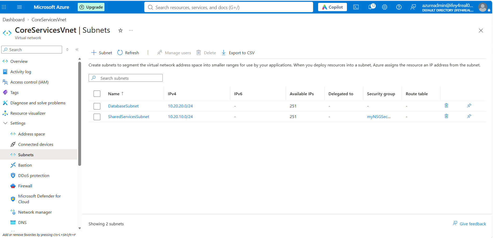
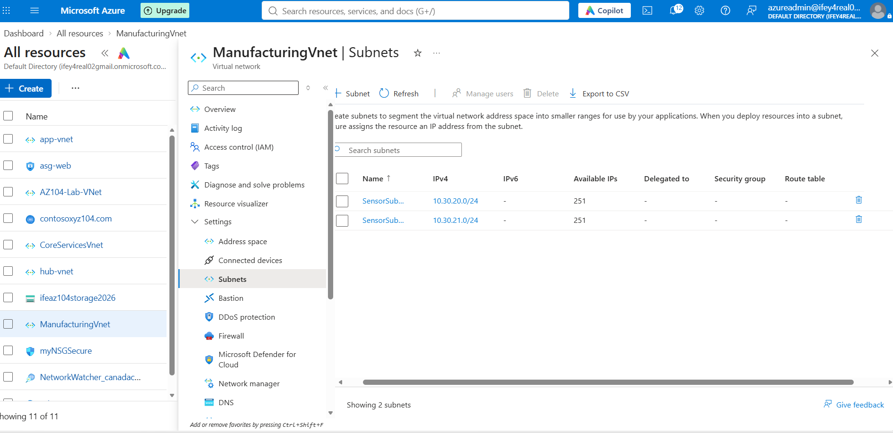
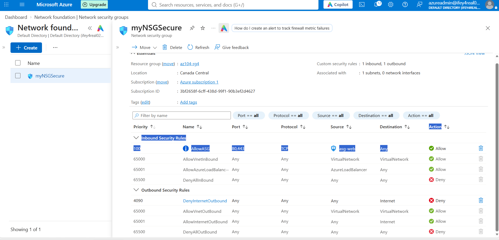
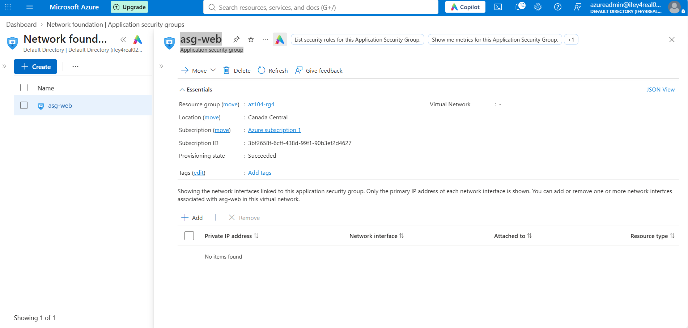
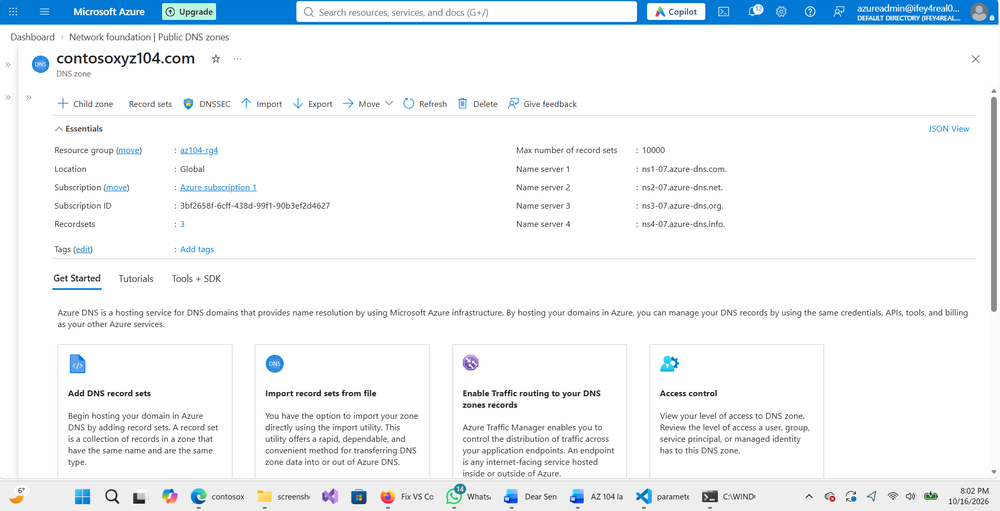
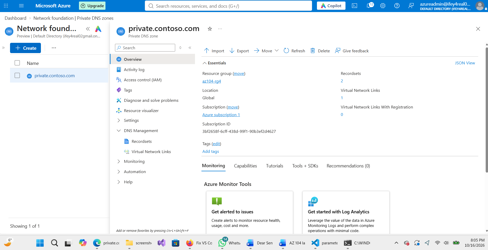
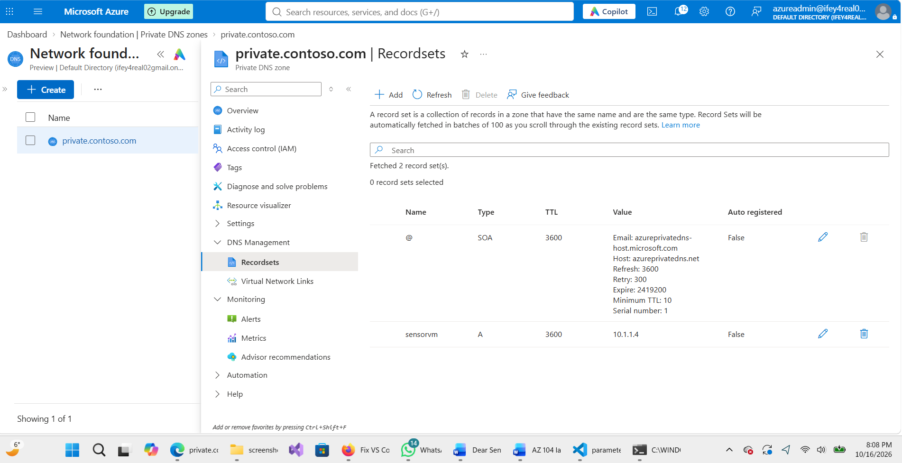
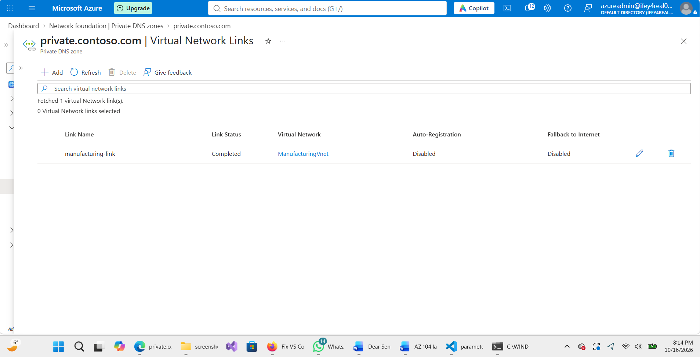

# Lab 03 — Implement Virtual Networking (AZ-104)

## Project Overview

This project documents my hands-on experience configuring and managing Azure virtual networking resources as part of my preparation for the Microsoft AZ-104 Azure Administrator certification.

I used the Azure portal and an Azure Resource Manager (ARM) template to deploy virtual networks, configure network security, and manage public and private DNS zones.

## Technologies Used

- Microsoft Azure Portal
- Azure Virtual Networks and Subnets
- Azure Resource Manager (ARM) Templates
- Network Security Groups (NSGs)
- Application Security Groups (ASGs)
- Azure Public DNS
- Azure Private DNS
- Visual Studio Code
- PowerShell / DNS troubleshooting tools

## Lab 1 — Virtual Network Configuration

Created `CoreServicesVnet` with address space `10.20.0.0/16`.

Configured two subnets:

| Subnet               | Address Range |
| -------------------- | ------------- |
| SharedServicesSubnet | 10.20.10.0/24 |
| DatabaseSubnet       | 10.20.20.0/24 |

### CoreServicesVnet — Azure Portal Configuration

## Lab 2 — ARM Template Deployment

Exported an ARM template and modified it to deploy a second virtual network, `ManufacturingVnet`, with address space `10.30.0.0/16`.

Configured:

| Subnet        | Address Range |
| ------------- | ------------- |
| SensorSubnet1 | 10.30.20.0/24 |
| SensorSubnet2 | 10.30.21.0/24 |

### ManufacturingVnet — Azure Portal Configuration

The ARM template and parameter files are preserved in the `templates` folder.

### Infrastructure as Code (IaC)

The ManufacturingVnet deployment was performed using
an Azure Resource Manager (ARM) template.

- `templates/template.json` defines the virtual network,
  address space, and subnets.
- `templates/parameters.json` provides the virtual network name.

The template was adapted from an Azure-exported deployment
and successfully used during the networking lab.

## Lab 3 — Network Security

Created an Application Security Group named `asg-web` and a Network Security Group named `myNSGSecure`.

Configured the following custom security rules:

| Rule                 | Direction | Priority | Action                        |
| -------------------- | --------- | -------- | ----------------------------- |
| AllowASG             | Inbound   | 100      | Allow TCP 80,443 from asg-web |
| DenyInternetOutbound | Outbound  | 4090     | Deny traffic to Internet      |

Associated the NSG with `SharedServicesSubnet`.

### Network Security Group — Inbound and Outbound Rules

### Application Security Group — asg-web

## Lab 4 — Azure DNS Configuration

### Public DNS

Created the public DNS zone `contosoxyz104.com` and configured an A record:

- Hostname: `www.contosoxyz104.com`
- IP address: `10.1.1.4`

Successfully queried the Azure DNS authoritative name server using `nslookup`.

### Public DNS Zone — contosoxyz104.com

### Private DNS

Created the private DNS zone `private.contoso.com`.

- Created A record `sensorvm` pointing to `10.1.1.4`.
- Linked the zone to `ManufacturingVnet` using `manufacturing-link`.
- Disabled automatic DNS record registration.

The IP address `10.1.1.4` was used for demonstration purposes. No virtual machine deployment or private DNS resolution test was performed.

### Private DNS Zone — A Record

### Private DNS — Virtual Network Link

## Verification

Verified the virtual network subnet configurations, network security rules, DNS recordsets, and virtual network link in the Azure portal.

Public DNS resolution was confirmed through a direct query to an Azure DNS authoritative name server. The command and result are saved in `Networking/dns-test.txt`.

## Key Skills Demonstrated

- Azure virtual network address planning and subnetting
- Infrastructure deployment using ARM templates
- Network traffic filtering with NSGs
- Application-based network security configuration
- Public and private DNS record management
- Azure resource verification and documentation

## Cleanup

The lab resources were deployed in the resource group `az104-rg4`. Resource cleanup should be performed after preserving the required configuration files and screenshots.

## Reference

[Microsoft Learn — AZ-104 Lab 04: Implement Virtual Networking](https://microsoftlearning.github.io/AZ-104-MicrosoftAzureAdministrator/Instructions/Labs/LAB_04-Implement_Virtual_Networking.html)
